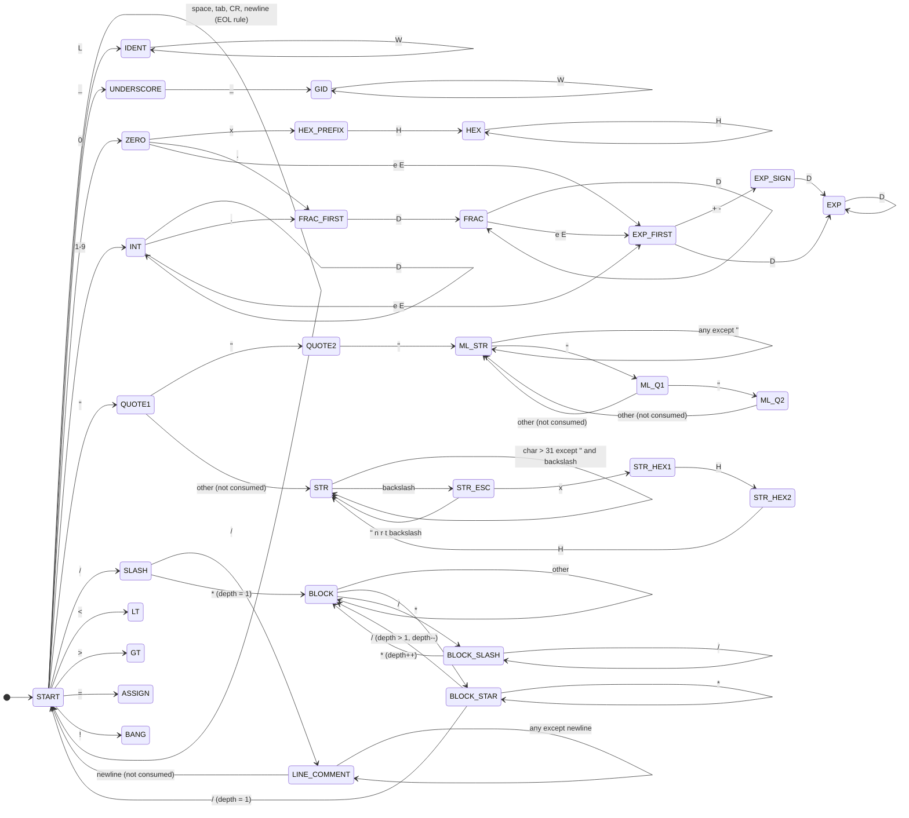

# IFJ25 – lexer finite automaton

State names match `State` in `src/lexer.c`. A transition labelled with a
character consumes it. "other" means any character not covered by another
transition from that state; an accepting state reached by "other" emits its
token **without** consuming that character (the next token starts with it).
Any missing transition is a lexical error (exit code 1).

Character classes: `L` letter, `D` digit, `H` hex digit, `W` letter/digit/`_`.

## Accepting states and their tokens

| State | On "other" emits |
|---|---|
| IDENT | keyword (table lookup) or `IDENT` |
| GID | `GID` |
| ZERO, INT, HEX | `INT` (error if "other" is a `W` character) |
| FRAC, EXP | `FLOAT` (error if "other" is a `W` character) |
| QUOTE2 | `STRING` (empty) |
| SLASH | `DIV` |
| LT / GT / ASSIGN | `LT` / `GT` / `ASSIGN`; with `=` consumed: `LE` / `GE` / `EQ` |
| BANG | only `!=` → `NE` |

Tokens emitted directly from START: `( ) { } , . * + -`, `EOL`, `EOF`.
`STR` emits `STRING` on a closing `"`; `ML_Q2` emits `STRING` on the third `"`
(after trimming the whitespace-only first/last line).

## Errors (exit code 1)

- `ZERO` followed by a digit (leading zeros), a number directly followed by a letter
- `FRAC_FIRST`, `EXP_FIRST`, `EXP_SIGN`, `HEX_PREFIX` without a digit
- newline, control character or end of file inside `"..."`
- unknown escape, `\x` without two hex digits
- end of file inside `"""..."""` or a block comment
- single `_` start, lone `!`, any other unexpected character
